<!-- This file is auto-generated. if you do not want it to be overwritten, set TRUE in the line below -->
<!-- DO_NOT_OVERWRITE_DOC=FALSE -->

# Installation Close Check

## Flow Diagram [(_View History_)](Installation_Close_Check-history.md)

<!-- Flow description -->

## General Information

|<!-- -->|<!-- -->|
|:---|:---|
|Object|Installation__c|
|Process Type|Auto Launched Flow|
|Trigger Type|Record Before Save|
|Record Trigger Type|Update|
|Label|Installation Close Check|
|Status|Active|
|Does Require Record Changed To Meet Criteria|✅|
|Description|An installation cannot be closed without an install date.|
|Environments|Default|
|Interview Label|Installation Close Check {!$Flow.CurrentDateTime}|
|BuilderType (PM)|LightningFlowBuilder|
|CanvasMode (PM)|AUTO_LAYOUT_CANVAS|
|Connector|[No_Install_Date](#no_install_date)|
|Next Node|[No_Install_Date](#no_install_date)|

#### Filters (logic: **and**)

|Filter Id|Field|Operator|Value|
|:-- |:-- |:--:|:--: |
|1|Status__c|Equal To|Completed|

## Flow Nodes Details

### Failed_to_get_handover_item

|<!-- -->|<!-- -->|
|:---|:---|
|Type|Custom Error|
|Label|Failed to get handover item|
|Custom Error Messages|errorMessage: Error while getting handover item records. isFieldError: false |

### Handover_Items_Not_Completed

|<!-- -->|<!-- -->|
|:---|:---|
|Type|Custom Error|
|Label|Handover Items Not Completed|
|Description|Not all handover items were completed|
|Custom Error Messages|errorMessage: Please complete all handover items before closure. isFieldError: false |

### Install_Date_Missing

|<!-- -->|<!-- -->|
|:---|:---|
|Type|Custom Error|
|Label|Install Date Missing|
|Description|Refuses to close an installation that was never given an install date.|
|Custom Error Messages|errorMessage: Set the install date before closing this installation. isFieldError: false |

### Incomplete_Handover_Items

|<!-- -->|<!-- -->|
|:---|:---|
|Type|Decision|
|Label|Incomplete Handover Items?|
|Description|Verify if there are incomplete handover items|
|Default Connector Label|No|

#### Rule Yes (Yes)

|<!-- -->|<!-- -->|
|:---|:---|
|Connector|[Handover_Items_Not_Completed](#handover_items_not_completed)|
|Condition Logic|and|

|Condition Id|Left Value Reference|Operator|Right Value|
|:-- |:-- |:--:|:--: |
|1|[Get_Handover_Item](#get_handover_item)|Is Blank|⬜|

### No_Install_Date

|<!-- -->|<!-- -->|
|:---|:---|
|Type|Decision|
|Label|No Install Date|
|Description|Was the installation ever given an install date?|
|Default Connector|[Get_Handover_Item](#get_handover_item)|
|Default Connector Label|Install date set|

#### Rule Date_Missing (Date missing)

|<!-- -->|<!-- -->|
|:---|:---|
|Connector|[Install_Date_Missing](#install_date_missing)|
|Condition Logic|and|

|Condition Id|Left Value Reference|Operator|Right Value|
|:-- |:-- |:--:|:--: |
|1|$Record.Install_Date__c|Is Null|True|

### Get_Handover_Item

|<!-- -->|<!-- -->|
|:---|:---|
|Type|Record Lookup|
|Object|Handover_Item__c|
|Label|Get Handover Item|
|Description|Get Handover item that is not completed|
|Assign Null Values If No Records Found|⬜|
|Fault Connector|[Failed_to_get_handover_item](#failed_to_get_handover_item)|
|Get First Record Only|✅|
|Store Output Automatically|✅|
|Connector|[Incomplete_Handover_Items](#incomplete_handover_items)|

#### Filters (logic: **and**)

|Filter Id|Field|Operator|Value|
|:-- |:-- |:--:|:--: |
|1|Is_Done__c|Equal To|⬜|

___

_Documentation generated from branch monitoring_orgfarm_3892286f4c_dev_ed_develop by [sfdx-hardis](https://sfdx-hardis.cloudity.com), featuring [salesforce-flow-visualiser](https://github.com/toddhalfpenny/salesforce-flow-visualiser)_